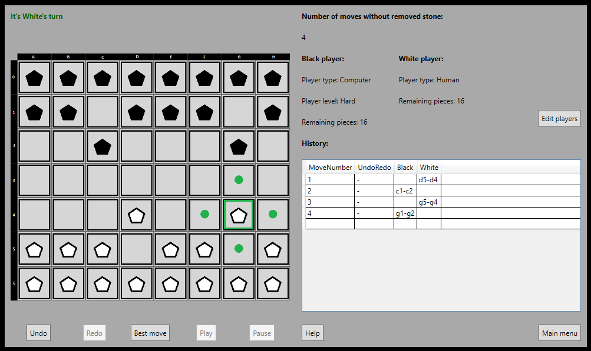

# Latrunculi

Latrunculi is an ancient board game [https://ancientgames.org/latrunculi/](https://ancientgames.org/latrunculi/) implemented as WPF application as part of school project.

## Table of Contents
- [Introduction](#introduction)
- [Installation](#installation)
- [Documentation](#documentation)
- [License](#license)

## Introduction
The purpose of this program is educational, to educate oneself about 
- Minimax algorithm and Alpha Beta Pruning optimization technique, find more info for example on [https://www.mygreatlearning.com/blog/alpha-beta-pruning-in-ai/](https://www.mygreatlearning.com/blog/alpha-beta-pruning-in-ai/)
- Dektop application development using WPF technology and MVVM architecture pattern
- Multithreading in C#

## Installation
Application was built and tested on Windows 11, using Microsoft Visual Studio Community 2019 at that time, and there is no quarantee below will work smoothly on a newer VS version too.

1. Download and install Visual Studio [https://visualstudio.microsoft.com/vs/community/](https://visualstudio.microsoft.com/vs/community/)

2. Download and install .NET Core 3.1 SDK from [https://dotnet.microsoft.com/en-us/download/dotnet/3.1](https://dotnet.microsoft.com/en-us/download/dotnet/3.1) or upgrade code to newer .net version

3. Clone the repository

4. Build from Visual Studio and play

## Documentation
The solution contains 3 projects:
- Latrunculi for the main logic, call it `Model`
- ConsoleApp for simple console app implementation
- WpfApp for desktop application

Note that this was my first time using the WPF technology or MVVM pattern - hopefully I understood the idea correctly, in the end it somehow works.

- `Views` folder contains possible application pages
    - their code-behind doesn't contain any logic, just displays data based on their viewModel
- `ViewModels` folders contains pages viewModels
    - viewModel is responsible for command execution / 'Model' update by calling 'model managers'
    - UI doesn't use 'Model' directly, but adapts it to UI specific 'model' using `GameplayManagerAdapter` component
- `MainWindowViewModel` component is responsible for navigation between the pages, and is trying to implement Mediator pattern [https://technical-recipes.com/2018/navigating-between-views-in-wpf-mvvm/](https://technical-recipes.com/2018/navigating-between-views-in-wpf-mvvm/)

## License
The project is unlicensed, see the [LICENSE](LICENSE) file for details.